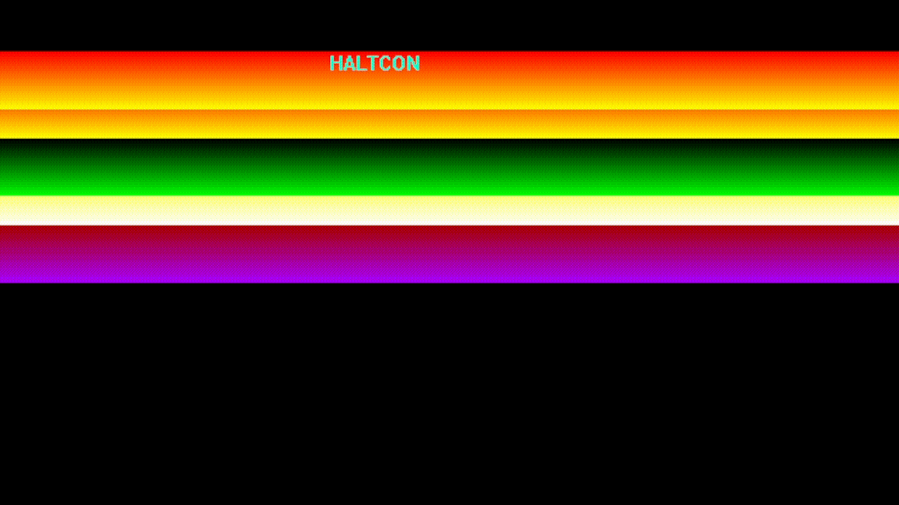

# HALTCON DemoScene Examples

A collection of demoscene experiments and graphical effects written in C.

Exploring low-level programming, software rendering, mathematics, and the art of real-time graphics under the HALTCON project.

---

## 001 - Copper Bars

A retro-inspired animated copper bars effect built using C and the native Windows API.

**Technologies:** C, Win32 API, GDI, Software Rendering.
